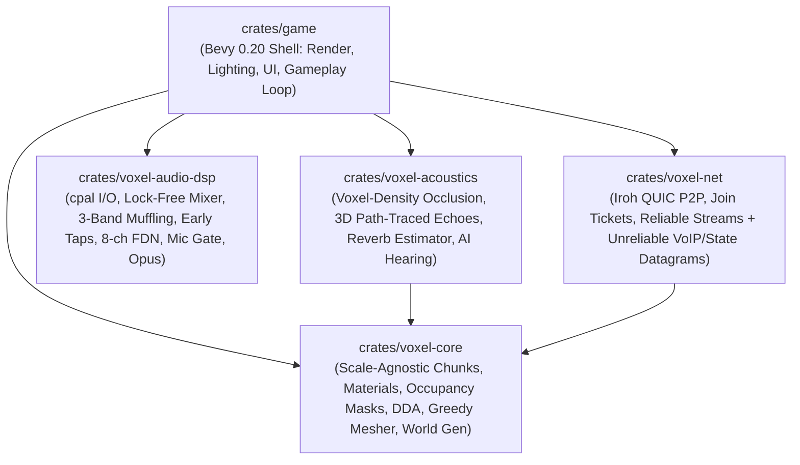
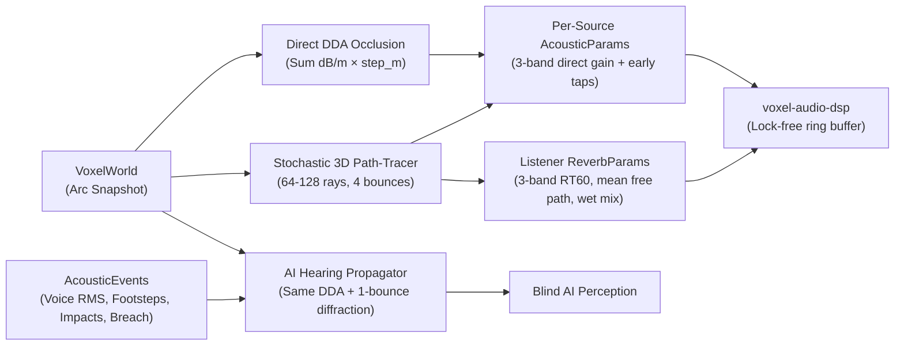
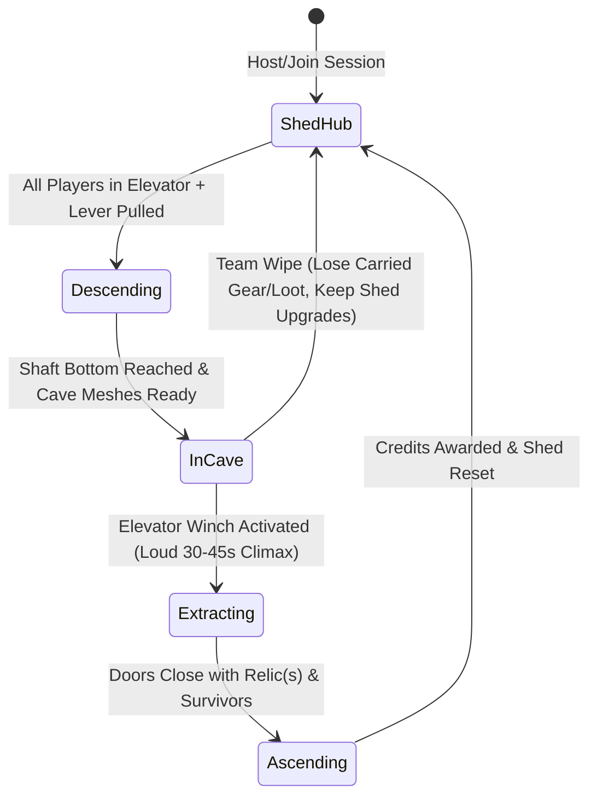

# Project Design & Implementation Plan: Co-op Voxel Acoustic Cave-Extraction Game

## Goal Description

Build a cross-platform (macOS, Windows, Linux) co-op voxel horror/extraction game in **100% Rust** for small friend groups (2–6 players), anchored around **physically grounded voxel acoustics**:

- **Core Fantasy:** Players gear up in a surface **Base Shed**, step into a sketchy mineshaft **elevator** (zero loading screen—continuous descent into pitch darkness while hearing every creak and moan), explore echoing procedural caves with flashlights, flares, and bioluminescent landmarks, haul heavy physical quest relics back to the shaft, and survive **blind predators** that hunt by sound—including the players' **real proximity voices** and every impact, footstep, and breached wall.
- **Signature Technical Pillars:**
  1. **Voxel-Density Occlusion + Path-Traced Audio:** Real-time DDA raymarching through voxel materials for frequency-dependent muffling behind walls, paired with stochastic 3D path-traced reflections for directional early echoes and dynamic cavern reverb—processing **both game SFX and built-in proximity voice chat**.
  2. **Zero-API Serverless Co-op:** Host-authoritative P2P networking using **`iroh`** (QUIC + automatic NAT hole-punching with stateless relay fallback). Host generates a copy-pasteable join code; friends paste it to join with no backend servers or APIs.
  3. **Scale-Agnostic Voxels (`1/2` now → `1/4` viable later):** All physics, player dimensions, speed of sound (`343 m/s`), and material attenuation (`dB/m`) are expressed in **meters**, parameterized by `VoxelConfig::voxel_size_m` (starting at `0.9 m`, cleanly switchable to `0.45 m` later).
  4. **Pragmatic Architecture:** **Bevy (`0.20`)** provides cross-platform `wgpu` rendering, dynamic point lighting/shadows, input, and UI, while all core domain systems live in **four decoupled, engine-independent custom Rust crates** (`voxel-core`, `voxel-acoustics`, `voxel-audio-dsp`, `voxel-net`).

---

## User Review Required

> [!IMPORTANT]
> **Key Design Decisions to Confirm Before Week 1 Scaffolding**
> 1. **Opus Codec Choice (`rusty-opus`):** To avoid C-compiler / `libopus` linking headaches across macOS, Windows, and Linux builds for your friends, this plan uses **`rusty-opus`** (pure-Rust Opus encoder/decoder) behind a small `VoiceCodec` trait so we can swap implementations without touching networking or DSP.
> 2. **Audio Output Isolation:** We bypass `bevy_audio` and run our own lock-free **`cpal` audio engine** (`voxel-audio-dsp`) so both SFX and VoIP share the exact same low-latency muffling biquads, early-reflection delay taps, and Feedback Delay Network (FDN) reverb.
> 3. **Deterministic Cave Generation for Fast Join/Sync:** Rather than streaming megabytes of raw voxel chunks over P2P during the elevator ride, the host sends a compact `LevelConfig` (seed + depth tier) plus a list of runtime voxel edits `(IVec3, VoxelId)`. Every client generates the base cave locally on background threads during the 10–15s elevator descent.
> 4. **Month-1 vs. Month-2+ Scope Boundary:** Month 1 delivers a complete, replayable "First Game Night" vertical slice (Shed → Seamless Elevator → Dark Cave → Proximity Voice Acoustics → Heavy Relic Drag/Duo-Lift → Blind Acoustic Monster → Downed/Aid Kit Revive → Loud Winch Extraction → Credits/Shop). Machinery (carts/forklifts), ropes/winches, modular ruins, and full skin customization are architecturally accounted for now and scheduled for Month 2+.

---

## Workspace & Crate Architecture

Keeping all custom engine subsystems outside Bevy ensures fast incremental compiles, clean headless unit/integration testing, and zero lock-in.



### Repository Directory Layout

```text
/Users/maks_weran/voxel/
├── Cargo.toml                        # Workspace manifest & shared dependency pins
├── crates/
│   ├── voxel-core/
│   │   ├── Cargo.toml
│   │   └── src/
│   │       ├── lib.rs
│   │       ├── config.rs             # VoxelConfig (voxel_size_m, world bounds)
│   │       ├── material.rs           # MaterialDef (acoustics, destructibility, visuals)
│   │       ├── chunk.rs              # 32³ Chunk + 4³ u64 brick occupancy mask
│   │       ├── world.rs              # Sparse ChunkMap, world_to_voxel / voxel_to_world
│   │       ├── dda.rs                # 3D Amanatides-Woo DDA with brick-skipping
│   │       ├── mesher.rs             # Greedy mesher with baked per-vertex AO
│   │       └── worldgen.rs           # Deterministic Shed + Elevator Shaft + Cave gen
│   ├── voxel-acoustics/
│   │   ├── Cargo.toml
│   │   └── src/
│   │       ├── lib.rs
│   │       ├── bands.rs              # 3-band [Low, Mid, High] dB/linear acoustic math
│   │       ├── occlusion.rs          # Direct-path voxel density transmission loss
│   │       ├── pathtracer.rs         # Stochastic multi-bounce raytracer (early taps + RT60)
│   │       ├── solver.rs             # Background worker thread & temporal smoothing
│   │       └── ai_hearing.rs         # Unified acoustic event propagation to blind AI
│   ├── voxel-audio-dsp/
│   │   ├── Cargo.toml
│   │   └── src/
│   │       ├── lib.rs
│   │       ├── engine.rs             # cpal host/stream setup & lock-free command rings
│   │       ├── biquad.rs             # Smoothed 3-band shelving/low-pass muffling filters
│   │       ├── spatial.rs            # ITD/ILD stereo panning + early reflection delay lines
│   │       ├── fdn_reverb.rs         # 8-channel Hadamard FDN driven by path-traced RT60
│   │       ├── voice.rs              # Mic capture, noise-gate calibration, RMS meter, jitter buf
│   │       └── codec.rs              # VoiceCodec trait + rusty-opus 20ms implementation
│   ├── voxel-net/
│   │   ├── Cargo.toml
│   │   └── src/
│   │       ├── lib.rs
│   │       ├── ticket.rs             # Copyable P2P join code serialization/validation
│   │       ├── protocol.rs           # Reliable messages & unreliable datagram packets
│   │       ├── host.rs               # Host-authoritative peer manager & broadcaster
│   │       └── client.rs             # Guest connection, reconnect/timeout, datagram bridge
│   └── game/
│       ├── Cargo.toml
│       └── src/
│           ├── main.rs               # App entry, Bevy plugins, fixed timestep
│           ├── state.rs              # AppState (MainMenu, ShedHub, Descending, InCave, Extracting)
│           ├── voxel_render.rs       # Chunk mesh upload to Bevy PBR + dirty-chunk queue
│           ├── physics.rs            # Meter-based AABB/capsule voxel collision & step-up
│           ├── player.rs             # First-person controller, footstep acoustics, stamina
│           ├── tools.rs              # Flashlight (battery), flares/torches, pickaxe, acoustic foam, decoys
│           ├── relic.rs              # Heavy physical relics (1p loud drag vs 2p quiet lift)
│           ├── elevator.rs           # Zero-loading seamless shaft descent & loud winch extraction
│           ├── ai_blind.rs           # Blind acoustic hunter state machine & pathing
│           ├── health.rs             # Downed state, dragging teammates, consumable Aid Kit revive
│           ├── shed.rs               # Base shed layout, mic calibration decibel wall, shop terminal
│           ├── net_bridge.rs         # Syncing Bevy ECS <-> voxel-net tokio runtime
│           └── audio_bridge.rs       # Syncing Bevy transforms/events <-> acoustics & DSP
└── assets/
    └── sfx/                          # Minimal procedural or CC0 base clips (creaks, footsteps, impacts)
```

---

## Deep Technical Design by Subsystem

### 1. `voxel-core`: Scale-Agnostic World, Materials & Fast DDA

#### Keeping `1/2` → `1/4` Scale Viable From Day One
All gameplay and physics constants are defined in **SI meters**:
- Player capsule: `height = 1.80 m`, `radius = 0.35 m`, `eye_height = 1.62 m`.
- Default `VoxelConfig`: `voxel_size_m = 0.90` (`2.0` voxels tall). Switching later to `0.45` (`4.0` voxels tall) changes grid resolution without rewriting movement speeds, gravity, jump height, light falloff, or audio propagation.

```rust
pub struct VoxelConfig {
    /// Physical edge length of a single voxel in meters (0.9m now, 0.45m later).
    pub voxel_size_m: f32,
    /// Bounded world extents in chunks (e.g., 8x8x8 chunks = 256³ voxels ≈ 230m³ at 0.9m).
    pub world_chunks: UVec3,
}
```

#### Chunk Memory & 2-Level Occupancy Acceleration
- **Chunk size:** `32 × 32 × 32` (`32,768` voxels) stored as `Box<[VoxelId; 32768]>` (`u8`, 32 KB per non-uniform chunk). Uniform chunks (all-Air or all-Bedrock) are stored as `ChunkStorage::Uniform(VoxelId)` (**1 byte**)—keeping a `256³` bounded cave under ~15–25 MB RAM.
- **Brick Occupancy Mask:** Each `32³` chunk maintains a `u64` bitmask covering its `4 × 4 × 4` sub-bricks of `8³` voxels. During DDA raytracing (both acoustic and line-of-sight), empty `8³` bricks are skipped in a single step—crucial when scaling to `1/4` voxels (8× volume).

#### Acoustic + Destructibility Material Registry
```rust
#[derive(Clone, Copy, Debug)]
pub enum Destructibility {
    Unbreakable,      // Bedrock, elevator shaft steel, outer shell
    BreakableCracked, // Soft/cracked cave rock & ruin masonry (breachable shortcuts)
    PlaceableTool,    // Acoustic foam, wooden/stone barricades placed by players
}

#[derive(Clone, Copy, Debug)]
pub struct AcousticMaterial {
    /// Attenuation per meter traveled through solid voxel [Low 250Hz, Mid 1kHz, High 4kHz] in dB/m.
    pub transmission_loss_db_per_m: [f32; 3],
    /// Energy reflected on surface bounce per band [0.0..1.0].
    pub reflection_coeff: [f32; 3],
    /// 0.0 = mirror-like reflection, 1.0 = fully diffuse Lambertian scatter.
    pub scattering: f32,
}
```

| Material | Destructibility | Transmission Loss (`L / M / H` dB/m) | Reflection (`L / M / H`) | Acoustic Role |
| :--- | :--- | :--- | :--- | :--- |
| **Hard Cave Stone / Bedrock** | Unbreakable | `8 / 18 / 32` | `0.85 / 0.80 / 0.70` | Strong cavern echo; passes muffled bass through thin walls |
| **Cracked Rock** | Breakable | `5 / 12 / 22` | `0.70 / 0.65 / 0.55` | Partially leaks sound before breaching; opens acoustic path once broken |
| **Timber / Shed Wood** | Unbreakable | `4 / 10 / 18` | `0.45 / 0.40 / 0.35` | Warm, cozy shed interior acoustics |
| **Steel (Elevator / Shaft)** | Unbreakable | `14 / 24 / 36` | `0.92 / 0.90 / 0.88` | Crisp metallic slap-back echoes in the shaft |
| **Acoustic Foam** | Placeable | `6 / 22 / 40` | `0.15 / 0.08 / 0.05` | Deadens echoes & muffles voices/machinery behind seals |
| **Bioluminescent Crystal** | Breakable | `10 / 20 / 30` | `0.90 / 0.92 / 0.95` | Subtle atmospheric landmark glow + bright ping resonance |

---

### 2. `voxel-acoustics`: Density Muffling, Path-Traced Echo & Unified AI Hearing



#### Stage A: Voxel-Density Muffling (Direct Path)
For each active sound source (remote player voice, monster, falling debris, flare, elevator winch):
1. Run 3D Amanatides-Woo DDA from `source_pos` to `listener_pos`.
2. For each solid voxel intersected over physical distance `Δd` (in meters), accumulate:
   $$\text{loss\_dB}[b] += \Delta d \cdot \text{mat.transmission\_loss\_db\_per\_m}[b]$$
3. Combine with geometric inverse-square distance falloff (clamped at reference distance `1.0 m`).
4. **Result:** Sound behind 2 meters of stone drops `~16 dB` in lows and `~64 dB` in highs → natural, physically accurate muffled thump without arbitrary binary "occluded/unoccluded" switches.

#### Stage B: Path-Traced Reflections (Echo & Dynamic Reverb)
On a dedicated background acoustic thread (~20–30 Hz update rate, amortized across frames):
1. **Listener-centric probe rays** (`64–128` Fibonacci-sphere + jittered rays, up to `4` bounces, max travel `80 m`):
   - At each voxel hit, record hit normal, distance `d_total`, and update ray energy `E[b] *= mat.reflection_coeff[b]`.
   - Choose next bounce direction by blending mirror reflection and cosine-weighted hemisphere scatter using `mat.scattering`.
2. **Early Reflections (`0–120 ms`):**
   - For active sources, cast short reflection-visibility probes (or check visibility from first-bounce hit points back to the source via DDA—classic next-event estimation!).
   - Cluster strongest valid reflection paths into up to **6 stereo delay taps** `(delay_sec = path_len / 343.0, gain_3band, direction_vec)` → produces genuine directional slap-back echoes down tunnels and around corners (diffraction-like leak around doorways!).
3. **Late Reverb Estimation (Dynamic FDN):**
   - From all ray bounce distances and energy decay rates, compute:
     - `mean_free_path_m` (characterizes room size: `3 m` in Shed vs. `28 m` in Grand Cavern),
     - `rt60_sec: [f32; 3]` per frequency band via Eyring/Sabine energy-decay fit,
     - `early_to_late_ratio` and `wet_gain`.
   - Temporally smooth all parameters (exponential smoothing `α ≈ 0.15`) so walking from a cramped wooden tunnel into a massive stone cavern transitions seamlessly with zero audio artifacts.

#### Stage C: Unified Blind-AI Hearing
- Every sound in the world emits an `AcousticEvent { pos, energy_3band, sharpness, kind, source_entity }`.
- Player voice RMS above the calibrated whisper floor emits periodic `AcousticEvent`s proportional to speech loudness (whispering carries ~4m and dies behind 1 wall; shouting/laughing carries 35m+ and echoes down shafts!).
- When evaluating whether a blind enemy hears an event, we run the **exact same DDA occlusion + 1-bounce corner check** between `event.pos` and `monster.pos`.
- **Frequency-selective monster archetypes:**
  - *Stalker (Month 1 primary):* High sensitivity to Mid/High bands & sharp transients (voices, dropped items, breaking rock, sprinting).
  - *Heavy Lurker / Brute (Month 1 stretch / Month 2):* High sensitivity to Low-frequency rumble (dragging heavy relics, explosions, future machinery).

---

### 3. `voxel-audio-dsp`: Real-Time Lock-Free DSP & Proximity VoIP

- **Thread safety:** The `cpal` audio callback thread **never allocates, never locks a mutex, and never touches Bevy ECS**. All state updates arrive via single-producer single-consumer lock-free ring buffers (`rtrb`).
- **Per-Source DSP Chain** (shared identically by SFX voices and decoded remote VoIP streams):
  1. **Direct Path Filter:** 3-band EQ / cascaded biquad low-pass filter controlled by `direct_gain: [f32; 3]`, parameter-slewed over `20 ms` to avoid clicks.
  2. **Stereo Spatializer:** Interaural Time Difference (ITD delay `0..0.65 ms`) + Interaural Level Difference (ILD + subtle far-ear low-pass head shadow) based on azimuth relative to listener head transform.
  3. **Early Reflection Delay Line:** Up to 6 tapped delays with directional panning and per-tap 3-band damping.
  4. **Late Reverb Send Bus:** Feeds into a shared **8-channel Hadamard Feedback Delay Network (FDN)** with mutually prime delay lengths scaled by `mean_free_path_m` and per-channel 3-band damping filters tuned to `rt60_sec: [f32; 3]`.
- **Voice Chat Pipeline (`48 kHz` mono, `20 ms` = `960` samples/frame):**
  1. `cpal` mic input → DC-blocking high-pass filter (`80 Hz`) → **Noise Gate** (threshold configured by player in the Shed's Decibel Calibration Wall) + soft whisper curve.
  2. Compute smoothed dBFS RMS → send to `game` for Shed meter UI and AI voice-noise emission.
  3. Encode `20 ms` frame via `rusty-opus` (`~24–32 kbps`, ~60–80 bytes/packet) → transmit via `voxel-net` QUIC unreliable datagram.
  4. Receiver places packet into a small adaptive **Jitter Buffer (`40–60 ms`)** with packet-loss concealment (Opus PLC) → decode to `f32` PCM → inject straight into the speaker's acoustic DSP source at their world head position!

---

### 4. `voxel-net`: Zero-API P2P Co-op via Iroh

- **Topology:** **Host-authoritative star** over `iroh::Endpoint` (`1.4.x`, pure-Rust QUIC via `noq`).
- **Join Code Flow:**
  1. Host clicks **Host Session** in Main Menu / Shed → spawns `iroh::Endpoint` with default n0 discovery & stateless relay fallback.
  2. Host serializes `EndpointAddr` (NodeId + direct socket hints + relay URL) into a compact copyable code (e.g., `ECHO-<base32>`).
  3. Friend clicks **Join Session**, pastes the code, and connects directly peer-to-peer (or via stateless relay automatically if behind strict symmetric NAT).
- **Transport Separation:**
  - **Reliable Bidirectional QUIC Stream (`postcard` framed):**
    - `Handshake { player_name, visor_color }` / `Welcome { player_id, shed_state }`
    - `StartDescent { level_seed, depth_tier }`
    - `VoxelDelta { coord: IVec3, material: VoxelId }` (only runtime modifications!)
    - `InteractRequest` / `InventorySync` / `ShopPurchase` / `RelicCarryState` / `PlayerHealthState`
    - `ElevatorStateChange`
  - **Unreliable QUIC Datagrams (`send_datagram`):**
    - `PlayerPose { tick, pos, yaw, pitch, crouch, anim_flags }` (~20–30 Hz)
    - `EntityPoseBatch` (relics, flares, blind monsters, ~20 Hz host → clients)
    - `VoiceFrame { speaker_id, seq: u16, opus_payload: [u8; ..] }` (~50 Hz, zero head-of-line blocking!)

---

### 5. `game`: Gameplay Loop, Seamless Elevator & Core Systems

#### Seamless Elevator Descent (Zero Loading Screen)


- **How zero-loading works:**
  1. The Surface Shed (`y = 200..225`) sits directly atop a physical vertical mineshaft (`y = 40..205`).
  2. When the host pulls the level lever, doors slam shut, the elevator car physically descends down the shaft with creaking metallic audio, flickering cage bulb, and shrinking surface daylight above.
  3. Simultaneously, the host sends `StartDescent { seed, depth_tier }`. Every client spawns background `AsyncComputeTaskPool` tasks to generate the cave chunks (`y = 0..160`) and greedy-mesh them.
  4. If generation finishes before the 12-second ride ends (expected: `< 2s` for `256³`), the elevator arrives right on cue; if a slower machine needs an extra second, the elevator seamlessly extends a brief "cable shudder/slip" beat before opening the doors!

#### Physical Weight-Scaled Relic Carrying
- **1 Player:** Grabs relic → movement speed `40%`, emits continuous loud low/mid **stone-scraping `AcousticEvent`** every `0.3s`.
- **2 Players:** Both grab opposite handles → relic lifts off floor, speed `75%`, scraping stops (only quiet footsteps!), requires verbal coordination around corners.
- **Dropping / Throwing:** Impact velocity triggers a sharp high-energy `AcousticEvent` that echoes down nearby tunnels and draws predators.

#### Downed State & Aid Kits
- Getting struck by a blind monster puts the player into **Downed** (bleed-out timer `60s`, slow crawl, muffled whispering still works!).
- Teammates can **drag** a downed friend to safety behind an acoustic foam seal, then use a **consumable Aid Kit** (`4s` channel with faint zipper/spray sound) to revive them.

#### Inventory, Subnautica-Style Batteries & Passive Gear
- **Active Belt / Hotbar Slots:** Start with **2 slots** (`[1]`, `[2]`), upgradeable in the Shed via **Tool Belt (+1)** and **Expedition Pack (+1–2)** up to **4–5 max** (keeps team roles meaningful—nobody carries everything alone).
- **Dedicated Battery Pouch (Subnautica-Style Swapping):**
  - Separate from active belt slots (starts at **2 battery slots**, upgradeable via **Pouch Upgrades** to **4–6**).
  - Every battery tracks its own charge (`0%..100%`, plus future high-capacity battery tiers) and can be **recharged back in the Base Shed** instead of discarded.
  - Pressing/holding **`R`** opens a fast **scroll-wheel battery selector** showing every battery in your pouch and its remaining `%`; scrolling selects which battery to swap into your flashlight (or future machinery), returning the old cell to your pouch with a subtle click sound.
  - **Battery Sharing:** Highlighting a battery in the **`R`** selector and pressing **`Q`** drops/tosses that physical battery cell onto the floor (with a metallic clatter sound!) so friends can pick it up when their light dies in the dark.
- **Passive Wearable Gear Slots (Permanent Shed Upgrades, Don't Clog Belt):**
  - **Headgear:** Start with a handheld flashlight (uses 1 belt slot). Buying a **Headlamp** later equips to the Headgear slot—freeing a belt slot and letting you see while carrying 2-handed heavy relics!
  - **Footwear:** Standard Boots → Soft-Sole Stealth Boots (quieter footsteps).
  - **Harness / Pouches:** Belt slot upgrades + Battery Pouch upgrades.
- **Two-Handed Heavy Carry State:** Heavy Quest Relics and dragging downed friends occupy **both hands**, holstering your active belt item (making headlamps and teammate lighting vital).
- **Consumable Stacks & Physical Acoustics:**
  - Stackable consumables per belt slot: Flares/Torches (`3–4`), Acoustic Foam Canister (`6–8` voxel charges), Noise Decoys (`2`), Aid Kit (`1`), Small Side-Loot (`1` per slot for greedy risk/reward tension).
  - Dropping any item (`Q`) spawns it physically and emits a real voxel-echoing impact sound; a heavily stuffed pack slightly increases sprint/jump noise.
  - **Persistent Base Shed & Campaign Saves (Never Reset Between Dives):**
    - Only the underground cave regenerates per dive—the Surface Shed persists across rounds so players can physically leave tools, flares, charging batteries, and trophies on **Shed shelves, racks, and benches** wherever they want.
    - **Host-Authoritative Save Files (`saves/<slot>.json`):** Auto-saves upon returning to the Shed (plus manual save). Stores shared credits, unlocked depth tiers, Shed upgrades, every physical item placed in the Shed (`pos_m`, `rot`, `charge/uses`), and per-player inventories/gear keyed by **Player Name** (requiring a simple local Player Name entry before Hosting/Joining so friends automatically restore their exact belt, battery pouch, passive upgrades, and visor/skin whenever they reconnect).

---

## Month-1 Execution Roadmap (4 Weekly Vertical Slices)

### Week 1: Dark Voxel Cave + Acoustic Engine v1
- **Deliverables:**
  - Initialize Cargo workspace + all 5 crates (`voxel-core`, `voxel-acoustics`, `voxel-audio-dsp`, `voxel-net`, `game`).
  - Implement `VoxelConfig` (`0.9m`), sparse `32³` chunks with `u64` brick occupancy masks, material registry, greedy mesher with vertex AO, and deterministic Shed + Shaft + Cave generator.
  - Implement meter-based capsule/AABB voxel player controller, dynamic flashlight (draining battery), throwable glow-flares (lifespan), bioluminescent crystal point lights, pickaxe breaking of `BreakableCracked` rock, and placing `AcousticFoam`.
  - Implement `voxel-acoustics` (DDA density occlusion + 64-ray 4-bounce path-tracer) + `voxel-audio-dsp` (`cpal` lock-free mixer, 3-band muffling filter, early reflection taps, 8-ch FDN reverb) wired to footsteps, impacts, and cavern ambiance.
- **Exit Criterion:** Walk around a dark procedural cave with a flashlight and flares, break a cracked wall or seal a tunnel with acoustic foam, and *clearly hear* footsteps/impacts muffle behind stone and echo realistically in open chambers.

### Week 2: Zero-API Iroh Co-op + Proximity Voice Through Acoustics
- **Deliverables:**
  - Implement `voxel-net` host/client over `iroh` with copyable join codes, reliable world/voxel-delta sync, and unreliable pose/voice datagrams.
  - Implement `voxel-audio-dsp` mic capture, Shed **Decibel Calibration Wall** (noise-gate threshold + live RMS bar), `rusty-opus` 20ms encode/decode, and adaptive jitter buffer feeding straight into the acoustic DSP pipeline.
  - Simple lobby UI (Host / Paste Join Code / Visor Color picker) + blocky voxel player avatars with visible flashlights.
- **Exit Criterion:** Two machines on different networks connect via pasted join code with zero external servers; players talk over proximity VoIP and hear each other's voices muffle behind walls, clear up when a wall is breached, and echo down the mineshaft.

### Week 3: The Core Loop (Seamless Elevator, Heavy Relics, Blind Monster, Extraction)
- **Deliverables:**
  - Implement seamless **Elevator Descent** state machine (no loading screen, creaking SFX, shrinking shaft light, async cave gen during descent).
  - Implement **Heavy Quest Relics** (weight-scaled 1p loud scrape-drag vs. 2p quiet lift + drop impacts), small bonus loot items, and throwable **Noise Decoys**.
  - Implement **Blind Acoustic Stalker AI** driven strictly by `voxel-acoustics::ai_hearing` (hears shouting, dropped relics, breached walls, sprinting; ignores quiet crouching behind walls/foam).
  - Implement **Downed State**, dragging teammates, consumable **Aid Kit** revive, and **Loud Elevator Winch Extraction** (30–45s tense holdout/escape).
- **Exit Criterion:** Complete end-to-end co-op dive from Base Shed → Elevator → Dark Cave → Relic Haul + Blind Monster Encounter → Elevator Extraction back to Shed.

### Week 4: Shed Shop, Level Tiers, Audio Tuning & Friend Playtest Build
- **Deliverables:**
  - Implement **Base Shed Shop & Credits** (sell extracted relics/loot; buy batteries, flares/torches, aid kits, noise decoys, acoustic foam canisters, quiet-boots upgrade).
  - Add 2–3 selectable **Depth Tiers** (varying cave openness, bioluminescence, relic value, and monster hearing sensitivity/count).
  - Tune acoustic curves (FDN damping, early reflection levels, voice whisper-vs-shout threshold for AI) based on live friend playtests.
  - Cross-platform release packaging scripts/builds for macOS, Windows, and Linux.
- **Exit Criterion:** A full, replayable co-op game night with friends with zero setup friction beyond pasting the host's join code.

### Post-Month-1 Roadmap (`v0.1.x` → `v0.5.0`)

> **Versioning Convention:** Incremental **Pre-release** drops ship as `vX.Y.Z` (`Z > 0`) leading *up* to the next major milestone (e.g., `v0.1.3`, `v0.1.4` → **`v0.2.0`** `Latest`; `v0.2.1`, `v0.2.2` → **`v0.3.0`** `Latest`), keeping SemVer strictly ascending and matching [.github/workflows/release.yml](./.github/workflows/release.yml).

- **`v0.2.0` (Big Release — *"First Game Night Ready"*, built across `v0.1.3` – `v0.1.x` pre-releases):**
  - **`v0.1.3` — Full Companion Carrying, Corpse Recovery & Signed Debt:** Synced P2P fireman-carry/drag for **Downed** teammates (voice whisper still works over carrier's shoulder, `[Space]`/`[Q]` escape to prevent griefing) + physical carryable **Fallen Bodies** for **Dead** teammates. Extracting with a fallen teammate's body avoids fines; leaving a companion behind incurs a **Company Recovery Fine (`-50 cr` per unrecovered body)**. Shared credits are signed (`i32`)—when at or below `0 cr`, the Supply Terminal refuses purchases until debt is paid off with extracted relics.
  - **`v0.1.3` — First-Person Held Tool Viewmodel:** Blocky diegetic held items (Flashlight, Pickaxe with `[LMB]` swing animation, Flare, Foam Canister, Noise Decoy, Aid Kit, Bonus Crystal, two-handed carry state).
  - **`v0.1.4` — Scarce Cave Salvage v1:** Rare, partially-used emergency supplies (20%–55% batteries, single flares, partial foam canisters, rusty decoys) tucked behind breakable `CrackedRock` alcoves (never replacing the Shed economy).
  - **`v0.1.4` — Shed Hub Polish & Readability:** In-world **Decibel Calibration Wall** (live 3D LED meter reacting to teammates' voices in the Shed), wooden gear shelves/racks, monster collapse animation, subtle Heavy Relic hum/pulse, and 2–4 player desync/reconnect fixes.
- **`v0.3.0` (Big Release — *Modular Ruins, Verticality & Heavy Haulers*, built across `v0.2.x` pre-releases):**
  - **Full Modular Ancient Ruins:** Stamped architectural prefabs (`PillaredNave`, `CollapsedCloister`, `SideCrypt`, `SunkenAltar`) with dense rubble/column cover, sealed crypt vaults, and higher-risk loot.
  - **Ropes & Anchors:** Purchasable & salvageable climbing ropes for vertical drop-chutes and elevated ruin balconies.
  - **Pushable Minecart / Utility Cart:** Multi-relic hauler emitting heavy low-frequency rumble that pulls **Heavy Lurkers** from across the maze.
  - **Upgraded Gear Tiers:** High-capacity batteries and reinforced acoustic foam.
- **`v0.4.0` (Big Release — *Acoustic Biomes & 3rd Predator*, built across `v0.3.x` pre-releases):**
  - **Acoustic Spore Biome:** Pitch-black by default; sound-reactive **Echo-Bloom** flora (pulses brief light when loud sound hits it), noisy **Snap-Pods** (crack loudly when stepped on), and sound-dampening **Moss** stealth paths.
  - **Obsidian Resonance Crystal Biome:** Dark glinting crystal walls/overhangs (keeping walkable floors clean), extreme high-frequency reverb (`RT60 > 3.0s`), and shatterable loud crystal veins.
  - **3rd Blind Predator — Echo Mimic:** Replays muffled snippets of recent player voices/clicks down branching tunnels to split teams up.
  - **Environmental Hazards:** Loudness-triggered ceiling rockfall dust and shallow water pools.
- **`v0.5.0` (Big Release — *Foley & Scale Pass*, built across `v0.4.x` pre-releases):**
  - Curated CC0/custom Foley WAV pass replacing remaining procedural synths, Shed suit/visor customizer + acoustic training corridor, and `1/4`-scale (`0.45 m`) voxel benchmark/evaluation.

---

## Verification Plan

### Automated Tests
1. **`voxel-core` unit tests** (`cargo test -p voxel-core`):
   - `world_to_voxel` / `voxel_to_world` invariance at both `voxel_size_m = 0.9` (`1/2`) and `voxel_size_m = 0.45` (`1/4`).
   - DDA raycast accuracy with brick-skipping compared against brute-force step traversal.
   - Greedy mesher face counts, winding order, and AO correctness on solid/hollow/checkerboard chunks.
   - Deterministic world generation reproducibility for identical seeds.
2. **`voxel-acoustics` unit tests** (`cargo test -p voxel-acoustics`):
   - Direct occlusion verifies thicker/denser stone attenuates High band dramatically more than Low band, and breaching a voxel immediately restores direct transmission.
   - Path-tracer verifies small wooden shed produces short RT60 (`< 0.5s`) while large stone cavern produces long RT60 (`> 2.0s`), and acoustic foam reduces reflected energy.
   - AI hearing verifies whisper behind a stone wall falls below threshold while shouting down an open corridor triggers detection.
3. **`voxel-audio-dsp` unit tests** (`cargo test -p voxel-audio-dsp`):
   - `rusty-opus` round-trip encode/decode frame integrity and latency (`20 ms` frames).
   - Biquad low-pass & FDN reverb stability (no NaN/Inf/runaway gain across extreme RT60 transitions).
4. **`voxel-net` integration tests** (`cargo test -p voxel-net`):
   - Local loopback `iroh` host + client handshake via serialized join ticket, reliable voxel-delta delivery, and unreliable datagram voice/pose exchange.

### Manual Verification (Weekly Playtests)
- **Week 1:** Acoustic A/B walk test—place a looping test sound in a cave chamber, walk behind 1, 2, and 3 voxels of stone vs. acoustic foam, break a 1-voxel peephole, and verify crisp muffling-to-clarity transition + cavern echo.
- **Week 2:** Two-machine internet playtest over different networks—host copies join code, guest joins without port forwarding, both test whispering vs. shouting around corners and through sealed walls.
- **Week 3:** Full stealth-in / chaos-out run with 2+ players testing duo relic carrying, solo drag scraping, decoy throwing, downed Aid Kit rescue, and blind monster acoustic tracking.
- **Week 4:** Full multi-run Shed progression playtest (buying upgrades/consumables, diving deeper, verifying macOS/Windows cross-play).
